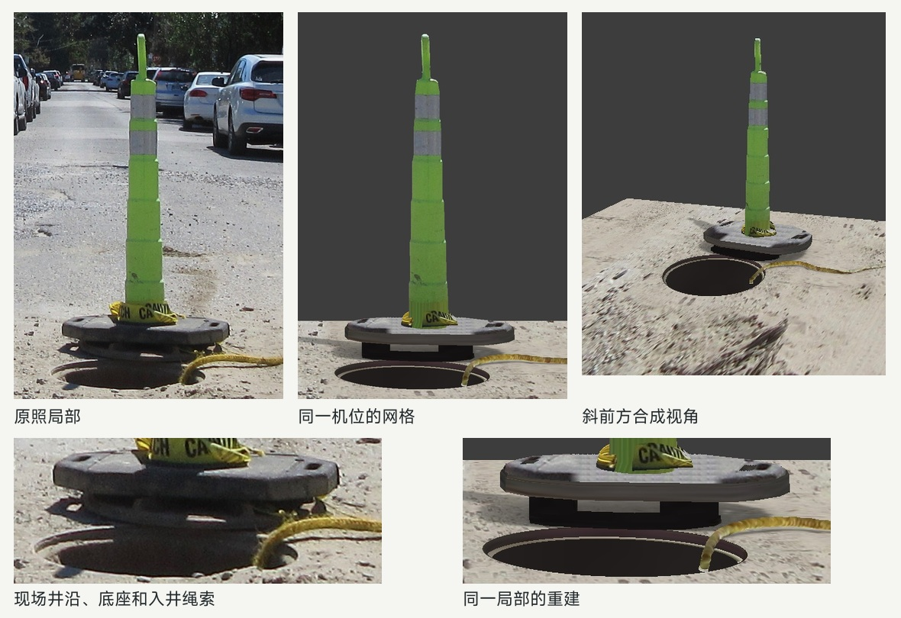
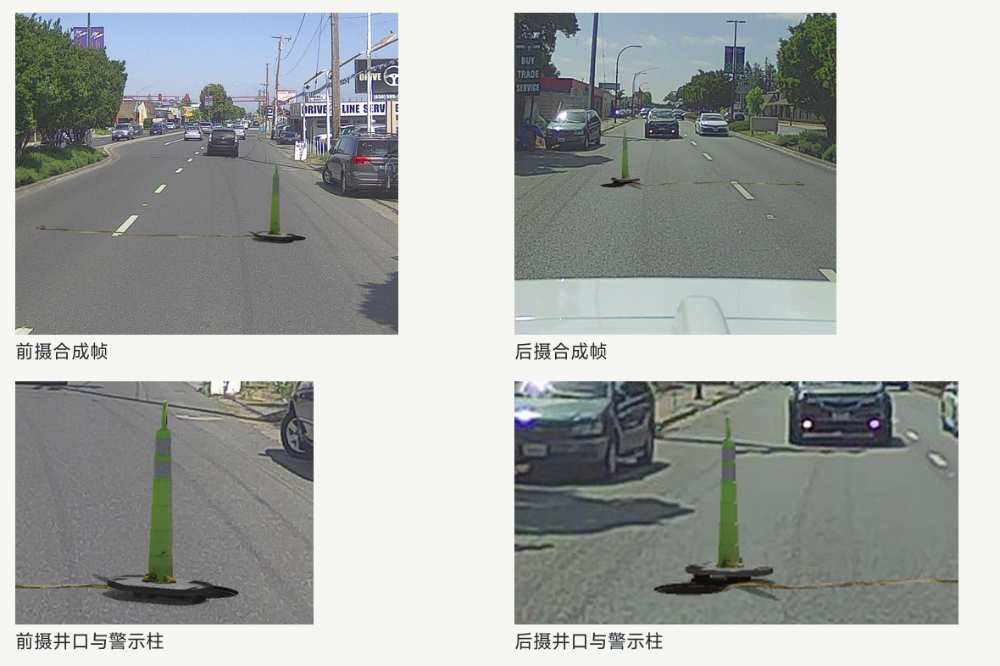

# M582 · 新奥尔良路口缺盖井、警示柱和入井绳索

2024 年 9 月 27 日，Infrogmation 在新奥尔良 Old Carrollton 的 Zimple 街与 Adams 街交叉口拍下一个敞开的人孔。绿色警示柱立在黑色配重底座上，一根黄色绳索从右侧路面折回并伸入孔内。模型保留了两段反光带、底座上两个贯通提孔、脚下能透光的窄缝，以及绳索远端可见的绕圈。现场照片只给出一个方向，盖板的去向和井底深度均未知。[现场原作和 EXIF](https://commons.wikimedia.org/wiki/File:Zimple_%26_Adams_Streets,_New_Orleans_27_Sept_2024_-_Open_manhole_in_the_middle_of_the_intersection.jpg) · [模型下载](https://github.com/Vexlc/road-hazard-reconstruction/releases/download/zimple-opening-v1.0.0/M582.zip) · [相机与激光下载](https://github.com/Vexlc/road-hazard-reconstruction/releases/download/zimple-opening-v1.0.0/camera-lidar.zip)

## 几何依据和自由度

|部位|照片提供的约束|模型采用的假设与核验|
|---|---|---|
|井沿与井座|在 5159 × 3683 原片上标记近沿及左右两侧，避开绳索、石子和警示柱遮挡。用 4.5 mm 焦距及 EXIF 横纵焦平面分辨率得到焦距 3748.7、3743.6 px。|假设井沿外径 0.60 m、主点在图像中心、局部路面为平面。27 个留出的点来自同一小段近沿，平均误差 0.75 px，最大 1.34 px；参与拟合的边界点中最大残差 7.70 px。远侧承托台按四个像点估计，低于路面约 23 mm。|
|警示柱和配重|按 23 个图像高度记录警示柱的左右轮廓，单独追踪底座上面及两处提孔。|名义尺度下柱顶高 1.36 m。把井沿外径改为 0.55、0.65 m 时，柱高相应为 1.24、1.47 m。按照片中另外 44 行的绿色像素检查左右边，共 88 个独立于控制行的边缘样本，投影 RMS 为 2.32 px。底部依可见轮廓补出支脚和下沿，背向原机位的纹理借用同部件的可见面。|
|黄色绳索|中心线在照片上可见，近端经过右侧井沿，远端在路上形成小圈。|采用 22 mm 绳径和逐站离地高度，沿投影控制点扫掠圆截面，保留局部弯曲与表面纤维。重建段沿中心线约 5.23 m。端部高度、绳的内部结构及隐没后的走向均缺少实测。|
|碎石路面和照明|直接采样无遮挡路面，并把同一张照片中的三块碎石样本投影回地面。|现场独立查看时采用估计的太阳方向和 32 个半球方向的遮光。迁入车辆场景后沿用宿主道路颜色，按宿主太阳方向重新算警示柱与绳索在地面的投影。只对已有摄影颜色的警示柱、绳索做曝光适配。|

标注中的坐标均以原片左上角为原点。仓库附原分辨率无损裁片，左上角为 (2600, 2050)，右下边界为 (5159, 3180)。原始 JPEG 和裁片的 SHA-256、各部件描点以及尺寸假设都在配方中。[配方](survey.json) · [相机求解](camera.py) · [几何和材质生成](build.py) · [原机位检验](validation/quality.json)

## 从现场照片复现

Linux、Python 3.9。直接查看 GLB 可使用支持 glTF 2.0 的查看器。下列命令用于重建整套资产并渲染高斯检查图，后一步使用 CUDA。绘图需系统提供 fontconfig 和中文字体。

~~~bash
git clone --depth 1 --branch zimple-opening-v1.0.0 https://github.com/Vexlc/road-hazard-reconstruction.git
cd road-hazard-reconstruction
python3.9 -m venv .venv
source .venv/bin/activate
KIT="$PWD/releases/field-chambers"
python -m pip install -r "$KIT/requirements.txt"
python -m pip install torch==2.4.0 torchvision==0.19.0 --index-url https://download.pytorch.org/whl/cu121
python -m pip install gsplat==1.4.0
export PYTHONPATH="$KIT/gen2hole/downstream:$KIT/gen2hole/downstream/sensors:$KIT/gen2hole/recipes/common:$KIT/gen2hole/recipes/series"
export OPENBLAS_NUM_THREADS=1 OMP_NUM_THREADS=2
D=gen2hole/examples/zimple-opening
B=build-zimple
python "$D/build.py" "$B/models/model"
python "$D/check.py" "$B/models" "$B/views"
~~~

|文件|可直接使用的内容|
|---|---|
|`asset.glb`|摄影纹理、井沿、可见承托台、警示柱、底座、绳索和路面。视觉遮蔽面在路面下 0.80 m，此数值用于遮住原本连续的宿主路面。|
|`observed.glb`|删除深处的视觉遮蔽面。查询车载量程时使用这份网格。射线可能命中井座、警示柱或绳索，也可能穿过井口而无返回。单视图无法看见的柱背和底座细节仍是几何补全。|
|`asset.ply`、`splat_material.npz`|原生一阶球谐高斯与逐高斯材质。GLB 为 Y 轴向上，PLY 与高度场为 Z 轴向上，单位均为米，原点在井口中心。|
|`surface.npz`、`metadata.json`|5 mm 网格及尺度、取材和部件信息。高度、首交部件、井口和量程有效掩码可直接读取。另存 10 mm 天空遮蔽网格；两类网格共享同一个米制范围。|

视觉网格含 60,940 个三角形，GLB 大小约 2.16 MB。平坦路面只需保留长方形外边界与 256 段井沿之间的三角形，原照纹理通过平面 UV 定位。429,534 个高斯在两个独立视角中，与网格的前景内部深度差 P90 分别约为 29、32 mm。

输出目录为 `$B/models/model/series/assets/missing/M582`。六份核心文件经过独立源码目录复建。井心竖直向下的探针在量程版中无返回；两个底座提孔的垂直探针均穿过上层配重并先碰到地面。5 mm 栅格中，能垂直穿过井口的面积约 0.243 平方米，计算时已考虑绳索和底座的遮挡。[重建指纹](validation/rebuild.json) · [核验程序](check.py)

## 复现自驾视角与激光回放

使用 PandaSet 109 的原始相机、激光、道路语义、动态掩码和传感器标定。在同一世界坐标植入资产，前摄得到 3 帧、后摄得到 8 帧。图中街道来自另一处实录，敞井、警示柱和绳索由 M582 合成。宿主的行驶方向会改变井沿与配重的前后遮挡。[PandaSet 原始数据入口](https://github.com/scaleapi/pandaset-devkit) · [相机验证](validation/camera.json)

~~~bash
raw=/path/to/raw/109
masks=/path/to/processed/109/dynamic_masks/all
for side in front back; do
  python "$KIT/scripts/render-road-distress.py" "$raw" "$masks" "$B/models" "$B/drive/$side" \
    --shot 15 --pixel 1190 925 --yaw-deg 70 --camera "${side}_camera" --semantic-occlusion \
    --focus-group 5 176 177 --relief-daylight gen2hole/examples/gervis-rupture/daylight.json M582
done
python gen2hole/examples/lane-damage/check_drive.py "$B/models" "$raw" "$B/drive" "$B/camera.json" --ids M582
python "$D/lidar.py" "$B/models" "$B/drive" "$raw" "$B/lidar"
python "$D/figures.py" "$B/views" "$B/drive" "$B/figures"
python "$D/pack_release.py" "$B/models" "$B/views" "$B/drive" "$B/lidar" "$B/release"
(cd "$B/release" && sha256sum -c SHA256SUMS)
~~~

逐束回放使用两台实录传感器各自的发射时刻与方向。11 个候选扫描有 8 个通过交通间距检查。在 25,268 条候选光束中，24,262 条保留原始量程，961 条提前命中警示柱或底座（669）及黄色绳索（292）。另有 25 条原道路回波改为可见几何首交。原始道路点距拟合路面须在 4 cm 以内，且原点位与光束过路面的位置都须落入井口，才允许挖去原路面回波。20 条穿入孔内后无已知表面可返回，两台传感器各占 6 和 14 条。

每个扫描文件保留原点云行号、传感器、时刻、局部光束、原量程、模型量程、状态及首交部件。状态 3 的模型量程为 NaN。部件 5 对应井圈或承托台、176 对应警示柱及配重、177 对应黄色绳索。[逐扫描统计](validation/lidar.json) · [激光回放入口](lidar.py)

原照 © Infrogmation。裁片、由原照制作的纹理及模型按 CC BY-SA 4.0 提供。改编包括裁切、描点、摄影配准、几何补全、纹理重采样和合成渲染。复用时请保留作者、出处、修改说明与相同许可。PandaSet 宿主另遵循原数据条款。[原照和授权](https://commons.wikimedia.org/wiki/File:Zimple_%26_Adams_Streets,_New_Orleans_27_Sept_2024_-_Open_manhole_in_the_middle_of_the_intersection.jpg) · [CC BY-SA 4.0](https://creativecommons.org/licenses/by-sa/4.0/)
