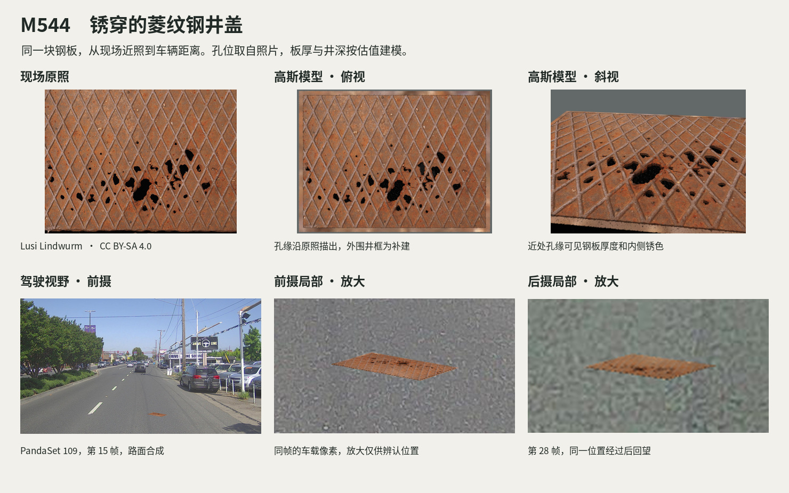
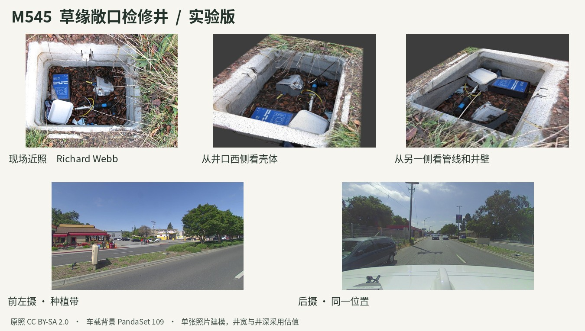

# 从现场照片重建两处井口病害

这两件资产适合检验一个具体问题：当相机或激光射线穿过井口时，首先碰到的是孔壁、壳体、线缆，还是井底？源码、原照、标注和参考数值均在本目录。成品压缩包另附高斯点云、封孔对照或新视角实渲、逐射线数据和车载回放。[下载本次 Release](https://github.com/Vexlc/road-hazard-reconstruction/releases/tag/field-chambers-v1.0.0)

| 资产 | 实拍依据 | 建模范围和状态 | 成品 |
|---|---|---|---|
| **M544 菱纹钢井盖锈穿** | 4608 × 3456 原照中 54 个可追踪孔口 | 已核验。单块钢板网格有 54 个贯通孔，含 SH1 高斯与同纹理封孔对照 | [M544.zip](https://github.com/Vexlc/road-hazard-reconstruction/releases/download/field-chambers-v1.0.0/M544.zip) |
| **M545 草缘敞口检修井** | 640 × 480 原照中的井座、井壁、落叶、三个壳体和交叉管线 | 实验版。近照可约束部件轮廓与前后关系，隐藏的侧面、井宽及绝对深度仍靠估计 | [M545-experimental.zip](https://github.com/Vexlc/road-hazard-reconstruction/releases/download/field-chambers-v1.0.0/M545-experimental.zip) |

## 只想查看或导入成品

在同一空目录下载两个 ZIP 和 Release 的 SHA256SUMS。下面的命令检查下载完整性、解到独立目录，再列出模型。只下其中一件时，先从 SHA256SUMS 选取对应文件那一行校验。

~~~bash
sha256sum -c SHA256SUMS
unzip -q M544.zip -d M544
unzip -q M545-experimental.zip -d M545
ls M544/series/assets/missing/M544
ls M545/series/assets/missing/M545
~~~

每件目录内的 `asset.glb` 可直接导入 Blender 或 glTF 查看器，单位为米，Y 轴向上。`asset.ply` 是 Z 轴向上的一阶球谐 3D 高斯，查看时需要支持 SH1、旋转、尺度和不透明度的渲染器。`surface.npz` 存放米制高度、开口和安装掩膜，`splat_material.npz` 的标签和 PLY 顶点顺序对应。M544 包内的 `sealed/asset.glb` 可用来测试同一条射线在封孔前后的量程变化。

## 从原照重建

参考运行环境为 Linux x86-64、Python 3.9.23。命令从新的空目录开始。网格重建使用 CPU；完整高斯导出使用 CUDA。建议先做网格，确认原照、比例和上下方向，再安装 GPU 依赖。

~~~bash
git clone --depth 1 --branch field-chambers-v1.0.0 https://github.com/Vexlc/road-hazard-reconstruction.git
cd road-hazard-reconstruction/releases/field-chambers
python3.9 -m venv .venv
source .venv/bin/activate
python -m pip install -r requirements.txt
export PYTHONPATH="$PWD/gen2hole/downstream:$PWD/gen2hole/downstream/sensors:$PWD/gen2hole/recipes/common:$PWD/gen2hole/recipes/series"
export OPENBLAS_NUM_THREADS=1 OMP_NUM_THREADS=2

python gen2hole/examples/rusted-cover/build.py source build/cover --mesh-only
python gen2hole/examples/verge-chamber/build.py source build/chamber --mesh-only
python check_delivery.py M544 build/cover/series/assets/missing/M544 --mesh-only
python check_delivery.py M545 build/chamber/series/assets/missing/M545 --mesh-only
~~~

每个建模入口都先校验原始照片的 SHA-256。成功后会生成网格、元数据、安装高度场和资产清单。下面是完整导出和 GPU 核验使用的 PyTorch、CUDA 与 gsplat 版本。gsplat 在首次调用时可能编译 CUDA 扩展，需要与 PyTorch 配套的 CUDA 工具链。

~~~bash
python -m pip install torch==2.4.0 torchvision==0.19.0 --index-url https://download.pytorch.org/whl/cu121
python -m pip install gsplat==1.4.0
python -c 'import torch; assert torch.cuda.is_available()'
python gen2hole/examples/rusted-cover/build.py source build/cover
python gen2hole/examples/verge-chamber/build.py source build/chamber
a=build/cover/series/assets/missing/M544
b=build/chamber/series/assets/missing/M545
python check_delivery.py M544 "$a"
python check_delivery.py M545 "$b"
~~~

参考环境对每件资产的 GLB、PLY、元数据、表面场和逐点标签做了独立重建，五个文件逐字节一致。换硬件或库版本后，哈希差异需要结合下面的几何和渲染核验解读。[M544 文件哈希](validation/rusted-cover-files.json) · [M545 文件哈希](validation/M545-files.json)

## 怎样验证真实感

**M544 的小孔有没有在导出时消失？** 以同张原照的 54 个孔内标记为起点，核对原图分割、闭合钢板的拓扑以及穿孔射线。最终网格有 680,810 个三角面，54 个孔心竖直射线均抵达井底。最差一孔的面积召回率由 75.0% 提到 96.3%。高斯俯视仍是 53/54 个可辨孔，原来只有 21/54；斜视时孔壁会挡住更多孔。这些数字衡量对该照片及网格的保真度。名义板宽 610 毫米、板厚 5 毫米、井深 310 毫米均为估计。[孔位与比例](gen2hole/examples/rusted-cover/survey.json) · [逐孔结果](validation/rusted-cover-openings.json) · [高斯核修订记录](validation/rusted-cover-refinement.json)

~~~bash
python gen2hole/examples/rusted-cover/build.py source build/sealed --sealed --mesh-only
python scripts/check-rusted-cover.py "$a/asset.glb" build/sealed/series/assets/missing/M544/asset.glb source/rust.jpg build/sections build/openings.json
python scripts/check-rusted-splats.py "$a" build/sections build/cover-views build/cover-optics.json
~~~

**M545 的线缆有没有贴在箱体上？** 按原照片配准相机。第一遍保存每条射线先命中的部件，第二遍移除前景部件、沿相同方向再投射。14 个标记点的首个部件和 5 组前后关系全部与标注一致。例如像素 (350, 224) 先碰到干草茎，再碰到浅色壳体；(282, 307) 先碰到黄线，再碰到金属轴。两组模型内量程差约为 99 与 21 毫米。井口名义宽 0.52 米、深 0.14 米；这些量程差不能作为实物测量。前井壁在原照只占十余行像素，修订版用同一张照片中较清楚的混凝土补足低分辨区域。另附西侧、东侧和低视点的网格及高斯渲染，可检查新露出的侧面。[部件标注](gen2hole/examples/verge-chamber/survey.json) · [遮挡检查点](gen2hole/examples/verge-chamber/witnesses.json) · [逐视角结果](validation/M545-optics.json)

~~~bash
python scripts/check-verge-chamber.py "$b" source/hill.jpg build/chamber-views build/chamber-optics.json
~~~

## 在车载数据上复用

Release 已附 PandaSet 109 的回放。M544 前摄、后摄代表帧分别有 76、17 条选中射线先命中锈蚀断面。192 条实录激光方向中有 8 条先碰到孔壁，7 条模拟量程增加超过 2 毫米。M545 放在有 Ground 标签回波支撑的中央种植带，前左摄和后摄各保留 8 帧。同一位置在两侧画面露出的壳体不同。比较依据是同一台相机、同一条实录方向上的合成结果，原车经过时路上并没有这两件资产。[M544 车辆与激光核验](validation/rusted-cover-road.json) · [M545 宿主位置与扫描行](gen2hole/examples/verge-chamber/host109.json)

若要重算 M545 车载回放，准备含相机、LiDAR、位姿、时间戳和语义标注的原始序列 109，以及该序列逐帧动态掩膜目录；这两个目录由调用者提供。使用前文生成的 `build/chamber/series`，执行：

~~~bash
raw=/path/to/raw/109
masks=/path/to/processed/109/dynamic_masks/all
for side in front_left back; do
  python scripts/render-road-distress.py "$raw" "$masks" build "build/vehicle/$side" \
    --support-survey gen2hole/examples/verge-chamber/host109.json \
    --camera "${side}_camera" --semantic-occlusion --focus-part 167 \
    --focus-group 165 167 169 --allow-hidden-focus M545
done
~~~

M544 使用同一段序列的前摄和后摄。放置目录只指向穿孔成品，封孔模型单独作为量程对照。先运行前面的 M544 封孔重建，再执行：

~~~bash
mkdir -p build/vehicle-models
ln -sfn ../cover build/vehicle-models/M544
for side in front back; do
  python scripts/render-road-distress.py "$raw" "$masks" build/vehicle-models "build/M544-vehicle/$side" \
    --shot 15 --pixel 1090 925 --yaw-deg 55 --camera "${side}_camera" \
    --semantic-occlusion --focus-group 164 6 --focus-part 164 --allow-hidden-focus M544
done
python scripts/check-rusted-road.py "$a/asset.glb" build/sealed/series/assets/missing/M544/asset.glb \
  "$raw" build/M544-vehicle build/M544-road.json
~~~

## 换自己的照片时

1. **先标可见证据。** 锈穿钢板优先标孔心、边缘和窄金属连接。敞井优先标上下井壁成对的位置，另选几个草茎、线缆与壳体真正交叉的像素。在新配方里记录原图尺寸、来源和哈希。
2. **为关键误差留对照。** 对孔口做同纹理封孔对照，可以识别画黑的假孔。对前后遮挡做部件移除试验，可以识别贴在同一平面上的管线。新增检查点时保留与预期不一致的位置，以便回到原照修订。
3. **用第二个视角检查隐藏区。** 原视角对得上并不能保证侧面厚度可信。M544 可参考沿孔缘旋转和缩窄高斯核的做法，M545 可参考按投影宽度调整实拍井壁纹理权重的做法。两个实现都保留了名义尺度和人工判断的位置。[孔缘实现](gen2hole/examples/parted-inlets/edge_kernels.py) · [井壁与部件实现](gen2hole/examples/verge-chamber/surfaces.py)

## 来源与署名

M544 现场原照由 **Lusi Lindwurm** 拍摄。改编包括裁切、孔口分割、三维建模和贴图，相关照片衍生资产遵循 CC BY-SA 4.0。路面和井壁辅材来自 ambientCG 的 CC0 资源。[原照](https://commons.wikimedia.org/wiki/File:F20-059_verwitterte-Schachtabeckung.jpg) · [CC BY-SA 4.0](https://creativecommons.org/licenses/by-sa/4.0/) · [Asphalt031](https://ambientcg.com/a/Asphalt031) · [Concrete049](https://ambientcg.com/a/Concrete049)

M545 现场原照为 **Richard Webb / Missing manhole cover**，2007 年 12 月 1 日摄，来自 Geograph。改编包括标注、投影配准、部件挤出、补绘隐藏区和多视角渲染，相关照片衍生资产遵循 CC BY-SA 2.0。车载宿主来自 Hesai Technology 与 Scale AI 的 PandaSet，使用遵循原数据条款。[原照](https://commons.wikimedia.org/wiki/File:Missing_manhole_cover_-_geograph.org.uk_-_627073.jpg) · [CC BY-SA 2.0](https://creativecommons.org/licenses/by-sa/2.0/) · [PandaSet](https://github.com/scaleapi/pandaset-devkit)
